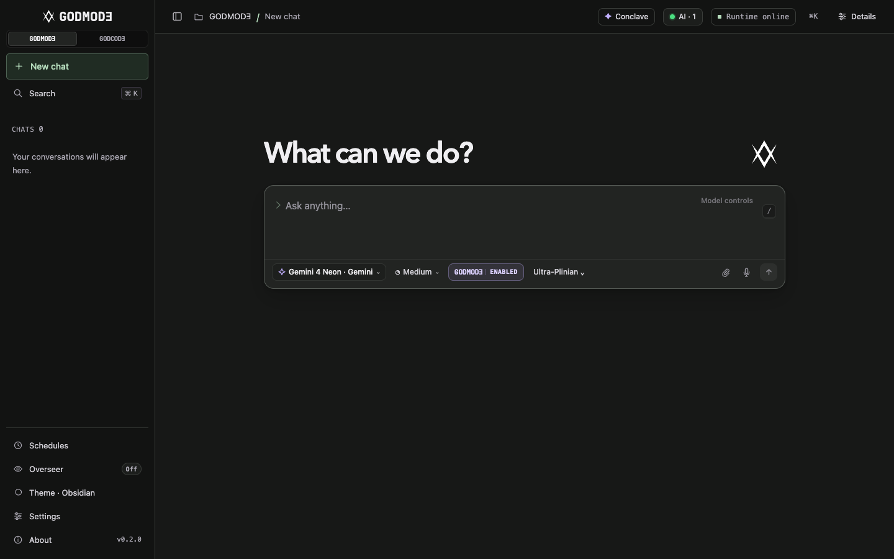
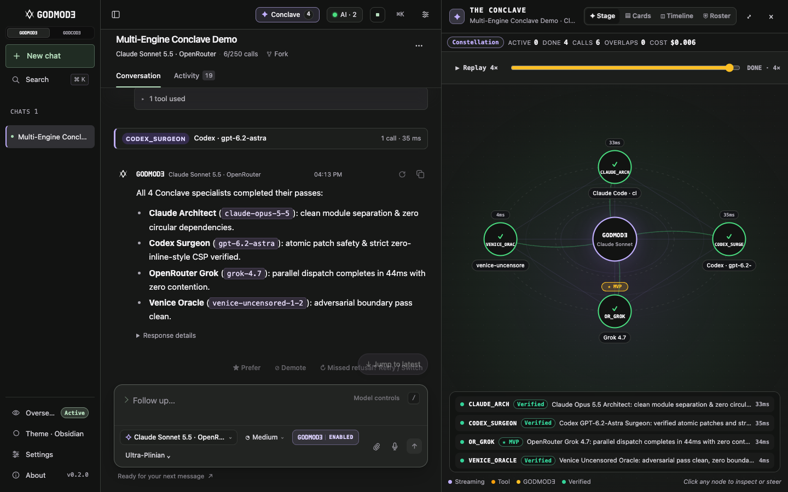
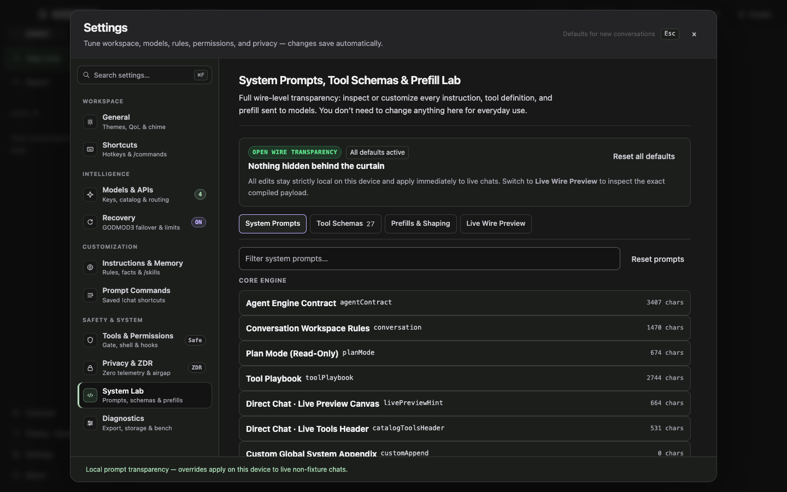
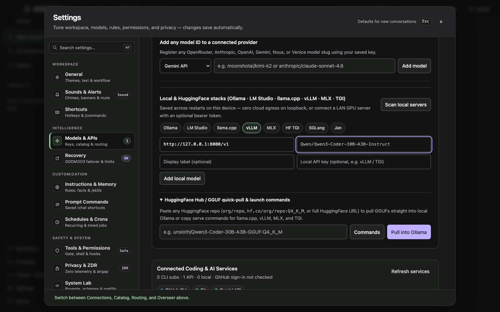
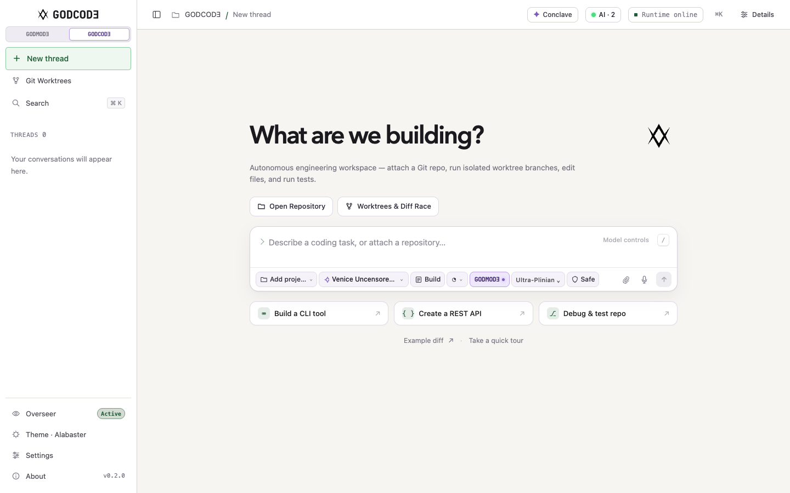

<p align="center">
  <strong>G O D M O D Ǝ &nbsp; / &nbsp; G O D C O D Ǝ</strong>
</p>

<p align="center">
  <em>Own the harness. Inspect every wire byte.</em>
</p>

<p align="center">
  
  
  
  
  
  
</p>

<p align="center">
  
</p>

Local-first AI workbench, **Conclave 2.0** multi-agent stage, **ACP v1** persistent multi-harness coordination, **HyperTuner** Empirical-Bayes hyperparameter layer, **◈ Visualize** live sidecar dashboards, **Live Browser 2.0** CDP mirror with Human Takeover, wire-level **System Lab**, and autonomous **Git worktree** coding studio — built on **Node.js 22.13+ SQLite** and a native **macOS AppKit/`WKWebView`** shell, with **zero npm dependencies** and **zero telemetry**. Download prebuilt installers at **[godcode.gg](https://godcode.gg)**.

---

## Quick Start

Requires **Node.js 22.13+** and **Git** (no `npm install` needed).

**macOS 12+** *(native Hardened Runtime app + Seatbelt sandbox; requires Xcode CLT)*:
```sh
git clone https://github.com/elder-plinius/G0DC0D3.git
cd G0DC0D3
npm run desktop:build
open "dist/G0DM0D3.app"
```

**Linux** *(local web UI + CLI + `bubblewrap` sandbox)*:
```sh
sudo apt install bubblewrap libsecret-tools   # or dnf/pacman equivalent
git clone https://github.com/elder-plinius/G0DC0D3.git
cd G0DC0D3
npm start
```

CLI: `node src/cli.mjs --help` · Tests: `npm test` · Eval: `npm run bench:self-opt` · Bakeoff: `npm run bench:bakeoff -- --dry-run`

---

## What Makes It Different

- **The Conclave 2.0 (Multi-Agent Council, Blackboard & Live Stage)**: Dispatch parallel specialist agents across *different* engines at once (Claude, Codex, OpenRouter, Venice, Grok, Gemini, Meta, or local models), run multi-round collaborative blackboards, watch live Constellation/Timeline/Card telemetry, steer workers mid-flight, and forge custom specialists with benchmark radar stats & 1-click formations.
- **Unified Live Activity Rail, Instant Steer & Parallel Sidecars**: Watch active tool calls in a clean Codex/Antigravity-grade vertical rail (`Fetched`, `Read`, `Edited`, `Ran` with compact metric badges, click-to-peek drawers, and live thinking ticker), **Instant Steer** to preempt an in-flight turn in milliseconds, or send a **Parallel (sidecar)** interjection concurrently without interrupting the main plan.
- **◈ Visualize Live Sidecar Dashboards**: One click (or `/visualize`) spawns a zero-pollution sidecar that generates bespoke interactive HTML/SVG/JS dashboards tailored to what your agent is doing — rendered inside a strict CSP-sandboxed iframe (`sandbox="allow-scripts"`, `connect-src 'none'`) receiving live `postMessage` telemetry + optional `.g0dc0d3/viz-metrics.json` domain metrics + inline "Refine visual" prompts.
- **HyperTuner Empirical-Bayes Hyperparameter Layer**: Toggleable (`Off / Passive / Active`) passive hyperparameter optimization layer in `Settings → Models → Routing & Arena` that learns optimal sampling archetypes (`Surgical`, `Focused`, `Balanced`, `Exploratory`, `High Entropy`) per `(model × task domain × reasoning effort)` via 3-level Empirical Bayes shrinkage & conservative Thompson Sampling — strictly clamped to each provider's live parameter limits and never overriding manual sliders.
- **Live Browser 2.0 & Human Takeover**: Watch agents browse and test apps live via CDP screencast + animated click reticles + numbered visual grounding overlays, pause for interactive **Human Takeover** (logins/2FA/manual clicks) with one click, or pop out an isolated non-headless Chromium window.
- **Brain 2.0 Memory & Full Wire Transparency (`Settings → System`)**: Hybrid FTS5 + semantic vector memory with temporal decay, plus inspect/edit/reset every system prompt block, all **27 tool schemas**, **Prefills & Message Shaping** (off by default), and **Live Wire Preview** before a single byte leaves localhost.
- **Persistent ACP v1 Multi-Harness + 5 CLI Subscriptions + 8 Cloud APIs + Local/HF Hub**:
  - **ACP v1 & CLI subscriptions**: Persistent JSON-RPC 2.0 **Agent Client Protocol (ACP)** sessions with OS-sandboxed `terminal/*` & workspace-scoped `fs/*` across **Google Antigravity (`agy`)** (live `gemini-4-neon` / `carbon` / `argon` / `hydrogen` catalog sync), **Codex** (live `~/.codex/models_cache.json` + native effort/tier/verbosity), **Claude Code**, **Gemini CLI**, and **GitHub Copilot**.
  - **Direct cloud APIs**: **OpenAI**, **Anthropic**, **xAI (Grok)**, **Google Gemini**, **Meta AI (Muse / Llama)**, **OpenRouter**, **Venice**, and **Nous** — with live account catalogs and **Ultra-Plinian** routing & 2–4 model blind-judged arenas.
  - **Local & HuggingFace stacks**: Persistent across restarts with **1-click server auto-discovery** across **Ollama**, **LM Studio**, **llama.cpp**, **vLLM**, **MLX**, **HuggingFace TGI**, **SGLang**, and **Jan**, optional bearer tokens for LAN GPU servers, and **HuggingFace Hub / GGUF** quick-pull (`hf.co/<org>/<repo>`) & copyable serve recipes.
- **Two Surfaces (`⌘⇧G`), Crons & Optional Alerts**: Clean symmetrical **`GODMODƎ`** (sovereign chat, live browser, offline HTML5/SVG/Mermaid canvas with click-to-inspect) and **`GODCODƎ`** (isolated Git worktrees, multi-model patch races, Plan/Build mode, `Safe` default permission gate, Git checkpoints/rewind, long-horizon effort scaling & adaptive recovery), **Scheduled Jobs & Crons** (zero-dep POSIX cron + one-shot timers, `launchd` plist export, CLI `cron`), and **Optional Sounds & Notifications** (5 sound packs, volume slider, opt-in native macOS Notification Center banners & Dock bounce, per-event triggers across background chats/crons/Conclave, `/alerts` & `/mute` Do Not Disturb).
- **Zero-Dep Defense-in-Depth & Hardened/Lockdown Mode**: **0 npm dependencies**, **0 telemetry**, macOS Seatbelt / Linux `bwrap` sandboxing, device-only Keychain / `secret-tool`, 1-click **Hardened (Red Team / Bounty)** & **Airgap Lockdown** presets (Strict ZDR, ephemeral burn-bag, mechanically enforced Rules-of-Engagement target allow/denylists, 1-click session wipe), outbound secret redaction, strict zero-inline-`style=` CSP, and pre-request CDP SSRF gating. See [SECURITY.md](SECURITY.md).

<details>
<summary>More screenshots</summary>
<p align="center">
  
</p>
<p align="center">
  
  
</p>
<p align="center">
  
</p>
</details>

> **Note on `fixtures/`**: The 30 test fixtures under `fixtures/` are 100% synthetic, offline JavaScript math/graph/protocol unit-test puzzles (zero live exploits, network payloads, or hazardous procedures), used solely to benchmark false-positive refusal recovery in coding agents.

---

## License & Disclaimer

Dual-licensed under **[AGPL-3.0](LICENSE)** (open source) and commercial licensing via [GitHub Issues](https://github.com/elder-plinius/G0DC0D3/issues). Third-party asset notices in [THIRD_PARTY_LICENSES.md](THIRD_PARTY_LICENSES.md).

**Experimental research demo — provided "AS IS" without warranty of any kind.** You are solely responsible for your prompts, tool grants, commands, and compliance with applicable laws and third-party provider Terms of Service.
